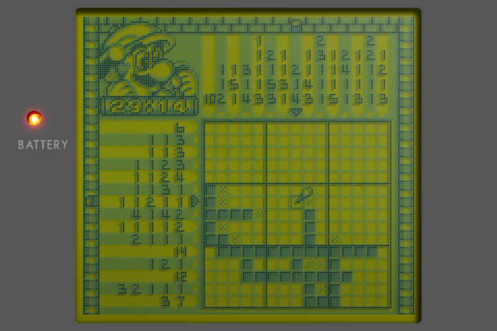
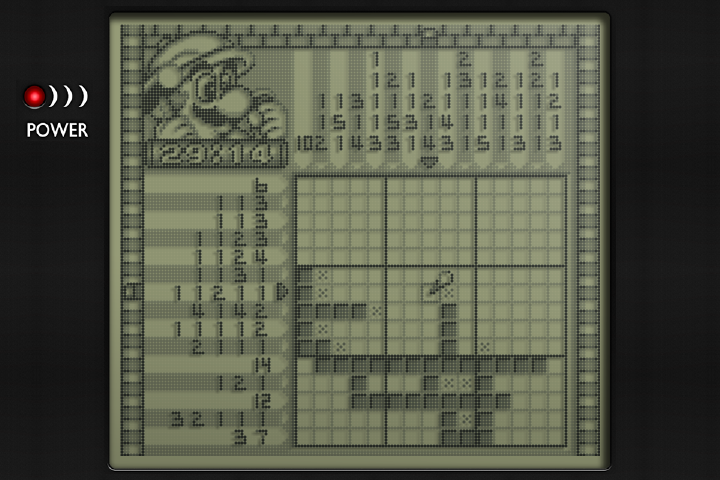
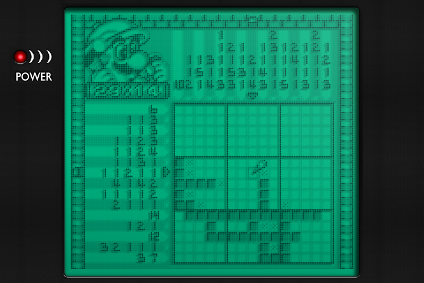
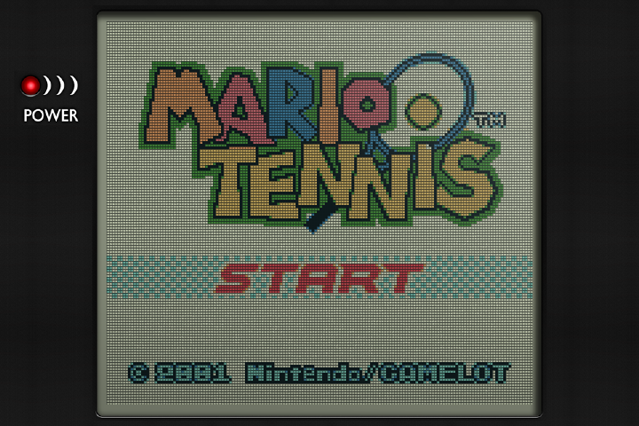
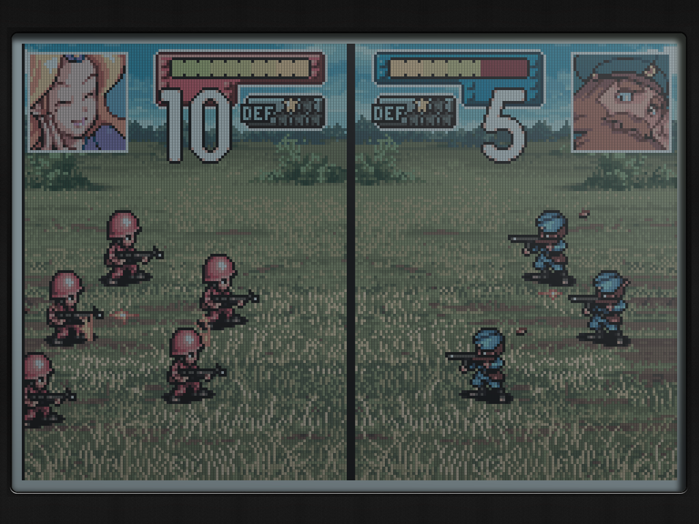

# Authentic LCD shaders

These shaders bring the texture and depth of the original LCDs to your handheld, complete with pixel grids, glass reflections and bezels.

Choose the Game Boy's yellow-green screen, the Pocket's pale grey-green, the Light's turquoise glow, or the subdued colours of the Game Boy Color and Game Boy Advance.

These shaders come from the Authentic screen mode in [my fork of slot](https://github.com/pvaibhav/slot).

| Game Boy | Game Boy Pocket | Game Boy Light |
|---|---|---|
|  |  |  |

| Game Boy Color | Game Boy Advance |
|---|---|
|  |  |

All examples are rendered with the included overlays. Game Boy, Pocket, Light and GBC use the RG35XX SP's 720x480 resolution. GBA uses the TrimUI Brick's 1024x768 resolution.

## The original screens

The Game Boy, Pocket, GBC and original GBA used the light around you to light the picture. Light passed through the LCD, bounced off a reflective backing and returned through the pixels. The shaders aim to capture what that looked like, right down to the shadows and texture beneath the glass.

- The Game Boy's dark dots are partly transparent, with the panel colour showing through. Soft shadows fall behind them, giving the picture the depth of an LCD above its backing. The Pocket has the same layered look in paler shades, while the Light adds its turquoise illumination.
- The GBC has a fine, sandy shimmer, like the reflective backing catching light through the colour filters. Its muted colours and transitions between shades draw on measurements of a real panel. The sparkle is a still texture, so it adds no flicker.
- The GBA has a cool, blue-white panel tint. Measurements taken with a spectrophotometer guide how its colours mix and how its shades darken. Brightness and contrast are adjusted to match the GBC preset on a modern screen.

The colour references are [Pokefan531's screen measurements](https://github.com/Pokefan531/Handheld-Colorspace-Shaders), the [Handheld Color Space Project](https://github.com/Brankale/Handheld-Color-Space-Project) and BGB's "GBC reality" colours. The Game Boy dot shading and bezels come from Harlequin's dmg-3x and gb-pocket-3x shaders. The Light palette comes from TWB64.

## Included overlays

Each screen look includes a matching overlay with tinted glass, reflections and a bezel that casts a shadow around the picture. The Game Boy uses a grey bezel; the other looks use the black Pocket bezel.

Overlays come in 640x480, 720x480, 720x720, 1024x768 and 1280x720. Choose your device's resolution and keep Screen Scaling on Native for the right fit. On the RG35XX SP's 720x480 screen, the GBA picture fills the display, so its overlay adds only the glass.

Versions without the bezel are included in `Overlays/<console>/Authentic panel only`. Move the one you want up one folder, then select it under Options > Overlay.

## Install and use on NextUI

1. Download `Authentic-GB-GBC-GBA.pakz` from the [latest release](../../releases/latest), copy it to the root of your SD card and start NextUI to install it.
2. Open a game, then go to Options > Shaders > Shader preset. Choose `authentic-dmg`, `authentic-pocket`, `authentic-light`, `authentic-gbc` or `authentic-gba`.
3. Under Options > Overlay, choose the matching screen and your device's resolution, such as `authentic-gbc-720x480.png`.
4. Save the settings for the console. Repeat for each console you play.

Keep Screen Scaling on Native so the picture fits the overlay. The presets set this for you, turn off the emulator's own colour correction and turn on LCD ghosting. Leave the Game Boy palette as the preset sets it.

For lighter or stronger Game Boy dot shadows, adjust `DOT_SHADOW` under Options > Shaders > Shader Settings. See the [NextUI guide](nextui/README.md) for more setup details.

## Licence

GPL-3.0, like Harlequin's gameboy shader and border art (libretro glsl-shaders, `handheld/console-border`) that this ports.
