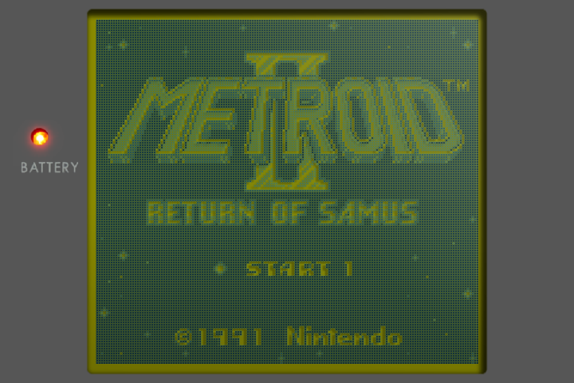
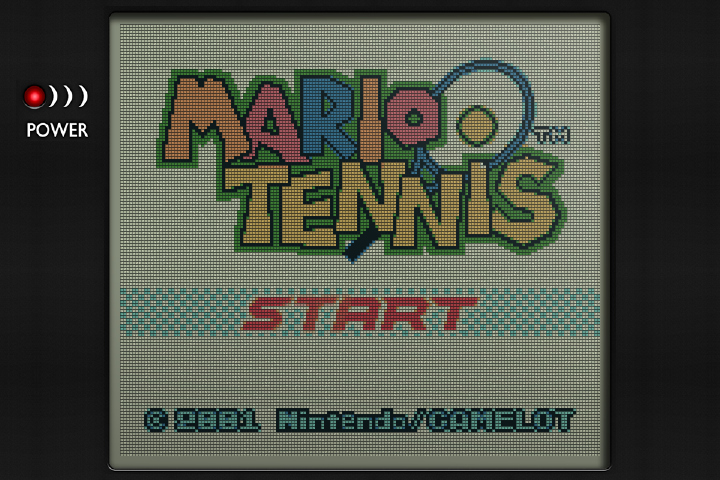
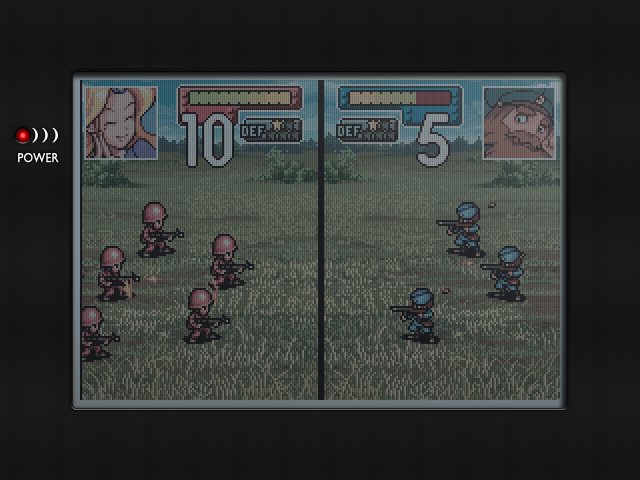

# Authentic LCD shaders for NextUI

Shaders and overlays that draw the Game Boy, Game Boy Pocket, Game Boy Light, Game Boy Color and Game Boy Advance screens as their reflective LCDs looked in room light. They are ported from the Authentic screen of [slot](https://github.com/pvaibhav/slot).

| Game Boy (RG SP) | Game Boy Color (RG SP) | Game Boy Advance (640x480, rendered) |
|---|---|---|
|  |  |  |

## Install

Download `Authentic-GB-GBC-GBA.pakz` from the [latest release](../../releases/latest), copy it to the root of your SD card and start NextUI. It installs and removes files from earlier releases.

Then, in a game, once per console:

1. Open Options > Shaders > Shader preset and pick `authentic-dmg`, `authentic-pocket`, `authentic-light`, `authentic-gbc` or `authentic-gba`.
2. Open Options > Overlay and pick the same screen at your device's resolution, for example `authentic-gbc-720x480.png`.
3. Save the settings for the console.

The presets set Screen Scaling to Native, which the overlays are drawn for. They also turn off the core's colour correction and turn on its LCD ghosting (Gambatte, gpSP or mGBA).

Overlays come in 640x480, 720x480, 720x720, 1024x768 and 1280x720. On a 720x480 screen the GBA picture fills the screen, so its overlay only adds the glass. Versions without the bezel are in `Overlays/<console>/Authentic panel only`. Move one up a folder to use it.

The Game Boy shaders have two settings under Options > Shaders > Shader Settings. `DOT_SHADOW` sets how dark the dots' shadows are (1 matches dmg-3x). `DOT_SHADOW_OFFSET` sets how far down and left they fall, in game pixels (dmg-3x uses 0.5).

## Performance

Each number is the GPU time for NextUI's whole frame: both shader passes at Native scale, the copy to the screen and the overlay. It is the median of 5 runs on real game frames, measured with `bench/bench.c`. A plain copy through the same steps is shown for comparison.

| Device (GPU, screen) | Plain copy | Game Boy | Pocket | Light | GBC | GBA |
|---|---|---|---|---|---|---|
| Anbernic RG35XX SP (Mali-G31, 720x480) | 0.83 ms | 2.23 ms | 2.45 ms | 2.34 ms | 2.64 ms | not measured |
| TrimUI Brick (PowerVR GE8300, 1024x768) | 2.77 ms (GB), 3.12 ms (GBA) | 4.65 ms | | | 5.67 ms | 4.99 ms |

A frame at 60 Hz is 16.7 ms.

## How it works

Each screen is two shader passes. The first runs once per game pixel. It works out each dot's ink and its share of the gaps between dots on a Game Boy, or each pixel's measured colour on the GBC and GBA. The second runs once per screen pixel and draws the dot grid, the dots' shadows and the GBC's sparkle. The bezel, its shadow and the glass reflection are drawn in advance into the overlay, so they cost one blend.

- Game Boy, Pocket and Light use Harlequin's dmg-3x and gb-pocket-3x settings and palettes.
- GBC uses BGB's "GBC reality" colours, fitted to Pokefan531's measured ramp.
- GBA uses Pokefan531's 2026 measured ramp and colour matrix and the panel's tint from the Handheld Color Space Project. Brightness and contrast match the GBC.
- The bezels are cut from Harlequin's dmg-3x and gb-pocket-3x border art. The GBC and GBA use the Pocket's.

## Building

```sh
python3 -m venv .venv && .venv/bin/pip install -r requirements.txt
.venv/bin/python src/build.py
```

This writes `build/dist/Authentic-GB-GBC-GBA.pakz`. `src/render.py` renders the shaders with desktop OpenGL for previews. `bench/bench.c` times a shader on the device. Build it for aarch64 and run it with no arguments for usage.

## Licence

GPL-3.0, like Harlequin's gameboy shader and border art (libretro glsl-shaders, `handheld/console-border`) that this ports.
